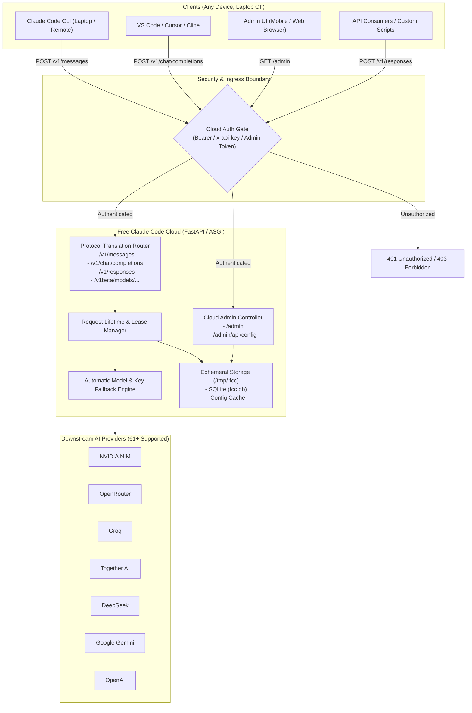
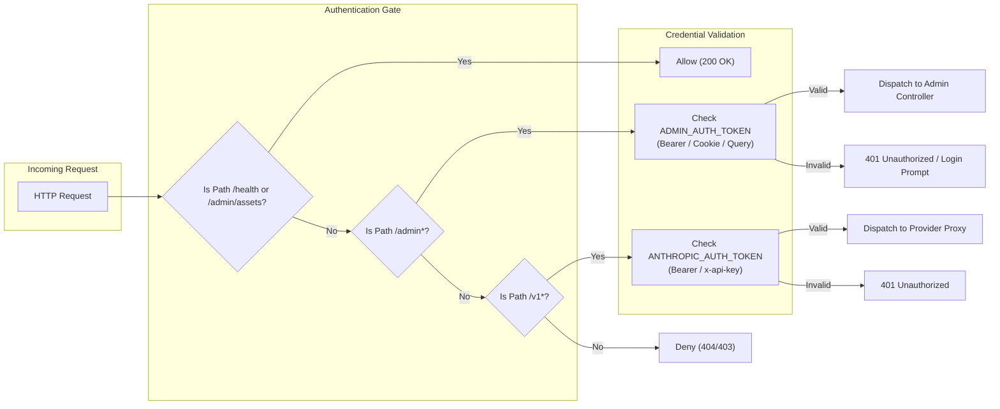

# Architecture Design: Free Claude Code Cloud

## 1. Architectural Overview

Free Claude Code Cloud is an AI Gateway and Reverse Proxy engineered to decouple local coding agents (Claude Code, Cursor, Cline, OpenCode, Aider, etc.) from local desktop execution. By deploying the service into a secure cloud environment, agents and tools across any device (laptop, tablet, phone, CI/CD runner) can route through a private, authenticated endpoint without requiring the developer's laptop to remain powered on.

---

## 2. Evaluation of Deployment Models

### Model A: Request-Driven Cloud Application (Primary — Vercel Serverless)

- **Nature:** Ephemeral, on-demand execution. Containers or serverless instances spin up on request and scale to zero when idle.
- **Applicability to Free Claude Code:**
  - **Core LLM Proxying:** 100% request-driven. Requests arrive, are routed to the upstream LLM provider, stream responses back, and complete.
  - **Admin UI:** Standard REST and static asset delivery.
  - **Cost:** Zero fixed cost on Vercel Hobby / Free Tier (within platform allowances).
  - **Laptop Independence:** Completely independent of the local computer.
- **Platform Constraints on Vercel:**
  - **Timeout Limit:** Vercel Hobby serverless functions have a max execution limit of 60 seconds (up to 300s on Pro).
  - **Filesystem:** Non-persistent, read-only root; only `/tmp` is writable.
  - **Background Daemons:** Persistent background loops (e.g. Discord/Telegram long-polling bots) cannot run continuously in serverless mode.

### Model B: Continuous Background Container (Secondary / Hybrid — Docker / Cloud Worker)

- **Nature:** Persistent, containerized process running Uvicorn (`Dockerfile` deployed on Render, Railway, Fly.io, or VPS).
- **Applicability to Free Claude Code:**
  - Ideal for workloads with very long streaming sessions (>60s reasoning chains) or if the user actively wants continuous Discord/Telegram bot integration.
  - Keeps persistent SQLite state on a mounted volume.

### Architectural Decision

We adopt a **Dual-Ready Cloud Architecture**:
1. **Model A (Vercel Serverless)** is the **Primary Target**:
   - The entire FastAPI proxy, Admin UI, and streaming engine are configured for seamless execution on Vercel via `@vercel/python` with an ASGI entrypoint (`api/index.py`).
   - Ephemeral file storage is routed to `/tmp/.fcc`.
   - Streaming is enabled via standard HTTP chunked transfer.
2. **Model B (Container / Docker)** is provided as a **First-Class Alternative**:
   - A multi-stage, hardened `Dockerfile` and `docker-compose.yml` are provided in the repository so that users needing unlimited timeouts or continuous Telegram/Discord bots can deploy to any container host with zero code changes.

---

## 3. Database Evaluation: Why Supabase is NOT Required

The user prompt specifies:
> "Database preference: No database unless required. Consider Supabase only when the existing application's architecture requires persistent database functionality."

Our thorough audit established that:
1. **Core Gateway is Stateless:** Routing requests, API key rotation, provider fallbacks, and SSE streaming do not read or write to a database.
2. **Configuration is Environment-Driven:** In cloud deployments, API keys and default models are supplied via secure environment variables (`os.environ`), rendering persistent local configuration files optional.
3. **Built-in SQLite Suffices:** Where SQLite is used (Code sessions history, messaging tokens), Python's native `sqlite3` in `/tmp/fcc.db` satisfies all runtime constraints without incurring external network hops, connection limits, or cloud database costs.
4. **Supabase Avoidance:** Introducing Supabase would add unnecessary latency to request paths, introduce external secrets to manage, risk egress charges, and provide zero architectural benefit for proxying requests. Therefore, Supabase is intentionally and cleanly omitted.

---

## 4. Cloud Security & Authentication Architecture

In a cloud environment, the application cannot rely on localhost loopback protection. We implement a multi-layered security boundary:

### Key Security Implementations:
1. **Cloud Admin Authentication (`require_cloud_admin`):**
   - Replaces the hard loopback rejection with a flexible, secure authentication check.
   - When deployed to cloud (`FCC_CLOUD_DEPLOYMENT=true`), requests to `/admin` and `/admin/api/...` must provide the valid admin secret via:
     - Header: `Authorization: Bearer <ADMIN_AUTH_TOKEN>`
     - Cookie: `fcc_admin_token=<ADMIN_AUTH_TOKEN>`
     - Query Parameter: `?token=<ADMIN_AUTH_TOKEN>` (for initial browser bookmark access)
   - Loopback access on localhost remains automatically authorized for local development.
2. **Mandatory Proxy Authentication:**
   - In cloud mode, `PROXY_AUTH_ENABLED` is automatically enforced if an authentication token is configured, preventing open-proxy vulnerabilities.
3. **Secure Headers Middleware:**
   - Adds `X-Content-Type-Options: nosniff`, `X-Frame-Options: DENY`, `Referrer-Policy: strict-origin-when-cross-origin`, and `Cache-Control: no-store` on sensitive endpoints.

---

## 5. Streaming and Timeout Strategy

- **Streaming:** Anthropic Messages, OpenAI Chat, and Gemini endpoints stream tokens incrementally using Server-Sent Events (SSE). Vercel Serverless Functions immediately flush chunks as they are generated by the upstream provider.
- **Timeout Awareness:**
  - Vercel Free / Hobby plan enforces a **60-second** timeout per request.
  - Vercel Pro allows up to **300 seconds** (configured via `maxDuration` in `vercel.json`).
  - For long multi-step agent queries, client tools (Claude Code, Cursor) automatically handle incremental streaming packets. As long as chunks are actively received, streaming maintains HTTP connectivity.
  - For tasks requiring >300s execution without timeouts, the included Docker container configuration provides an unrestricted hosting path.
