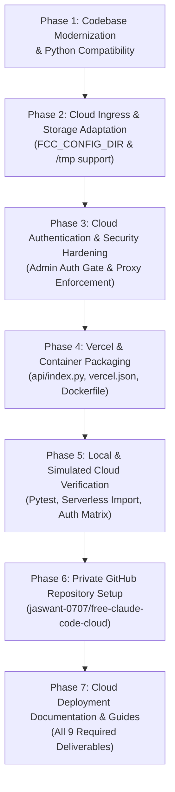

# Implementation Plan: Free Claude Code Cloud

## Objectives

Transform the local `free-claude-code` repository into a secure, production-ready, cloud-hosted application (`free-claude-code-cloud`) accessible via a private URL without needing the user's laptop to remain on.

---

## Phased Implementation Roadmap

---

## Detailed Task Breakdown

### Phase 1: Python Grammar & Environment Modernization
- **Task 1.1:** Fix all 54 instances of Python 3.14-only unparenthesized `except E1, E2:` syntax across `src/` to universal `except (E1, E2):`.
- **Task 1.2:** Update `pyproject.toml` from `requires-python = "==3.14.10"` to `requires-python = ">=3.12"` to enable execution on Python 3.12 (Vercel standard) and Python 3.14.
- **Task 1.3:** Verify full syntax compilation across the entire tree using `python -m compileall -q src`.

### Phase 2: Cloud Filesystem & Storage Adaptation
- **Task 2.1:** Modify `src/free_claude_code/config/paths.py` to check `os.getenv("FCC_CONFIG_DIR")`. If running in AWS Lambda / Vercel (`VERCEL="1"` or `AWS_LAMBDA_FUNCTION_NAME` set), automatically default to `/tmp/.fcc` if `~/.fcc` is not writable.
- **Task 2.2:** Ensure SQLite database initialization safely creates directories in `/tmp` without crashing.

### Phase 3: Cloud Authentication & Security Hardening
- **Task 3.1:** Upgrade `src/free_claude_code/api/admin_security.py` to implement `require_cloud_admin(request: Request)`.
  - Retain automatic approval for local loopback connections.
  - In cloud deployments, validate credentials via:
    - `Authorization: Bearer <ADMIN_AUTH_TOKEN>` or `<PROXY_AUTH_TOKEN>`
    - Cookie: `fcc_admin_token`
    - Query parameter: `?token=<token>` (with automatic cookie set on initial browser navigation).
- **Task 3.2:** Wire `require_cloud_admin` into `admin_routes.py` and `code_sessions_routes.py`.
- **Task 3.3:** Update `src/free_claude_code/config/settings.py` so that when `FCC_CLOUD_DEPLOYMENT=true` or an auth token is set, proxy authentication defaults to enforced (`PROXY_AUTH_ENABLED=True`).
- **Task 3.4:** Add standard security headers middleware in `src/free_claude_code/api/app.py` (`X-Frame-Options`, `X-Content-Type-Options`, `Referrer-Policy`).

### Phase 4: Vercel & Container Packaging
- **Task 4.1:** Create `api/index.py` as the Vercel Serverless Function entrypoint exposing the ASGI `app`.
- **Task 4.2:** Create `vercel.json` configuring `@vercel/python`, API routing, and max duration settings.
- **Task 4.3:** Create a standalone, trimmed `requirements.txt` specifically optimized for cloud serverless deployment (excluding desktop GUI libraries like `pystray` and `Pillow`).
- **Task 4.4:** Create production-grade `Dockerfile` and `docker-compose.yml` for Model B (container/VPS alternative).
- **Task 4.5:** Update `.gitignore` to prevent any local credentials, cache files, or environment files from being committed.

### Phase 5: Verification & Testing
- **Task 5.1:** Execute pytest test suite on modified files to verify no regressions in API routes, auth, or handlers.
- **Task 5.2:** Test local serverless startup and simulated cloud invocation through `api/index.py`.
- **Task 5.3:** Test Admin UI authentication: verify loopback pass, remote rejection without token, and remote pass with token.
- **Task 5.4:** Verify proxy authentication on `/v1/messages` and `/v1/chat/completions`.

### Phase 6: Private GitHub Repository Preparation
- **Task 6.1:** Inspect git status and review diffs.
- **Task 6.2:** Scan for any credentials or secrets before committing.
- **Task 6.3:** Commit changes with descriptive engineering messages.
- **Task 6.4:** Configure remote `https://github.com/jaswant-0707/free-claude-code-cloud` (private) and push.

### Phase 7: Comprehensive Documentation Delivery
- Deliver all 9 comprehensive markdown files required:
  - `README.md`
  - `AUDIT_REPORT.md`
  - `ARCHITECTURE.md`
  - `IMPLEMENTATION_PLAN.md`
  - `DEPLOYMENT_GUIDE.md`
  - `SECURITY_AUDIT.md`
  - `TEST_REPORT.md`
  - `ENVIRONMENT_VARIABLES.md`
  - `FINAL_REPORT.md`

---

## Risk Assessment and Mitigation

| Risk | Impact | Mitigation Strategy |
| :--- | :--- | :--- |
| **Vercel Execution Timeout** | Long streaming requests could be cut off at 60s on Vercel Hobby. | Configure `maxDuration: 60` (or `300` on Pro) in `vercel.json`; document container option for multi-minute uninterrupted agent sessions. |
| **Serverless Cold Start** | Initial request latency of ~1-2s while Python runtime initializes. | Keep dependencies clean, lazily load optional libraries, avoid heavy imports at module root. |
| **Ephemeral State Loss** | Admin configuration saved to `/tmp/.fcc` resets on cold container restart. | Emphasize configuring environment variables directly in Vercel project settings (`process.env`), which persist across all instances. |
| **Admin UI Lockout** | Users unable to open admin page remotely. | Support multiple auth mechanisms: Bearer token, query token (`/admin?token=...`), and automatic session cookie. |
| **Credential Leakage** | Leaking API keys or tokens in git or logs. | Strict `.gitignore`, pre-commit secret scans, log masking (`MASKED_SECRET`), and storing keys exclusively in Vercel Environment Variables. |
