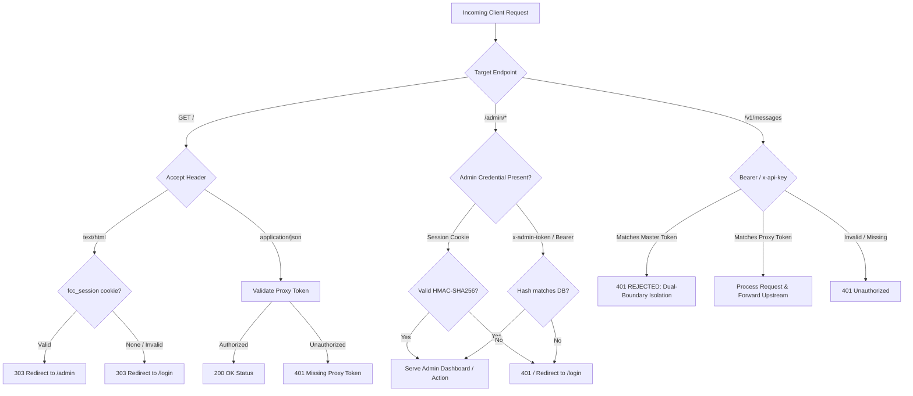
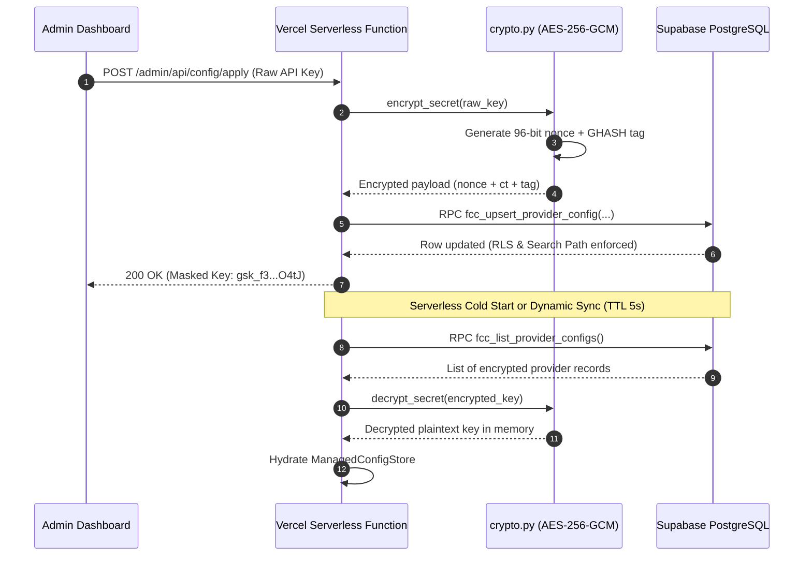
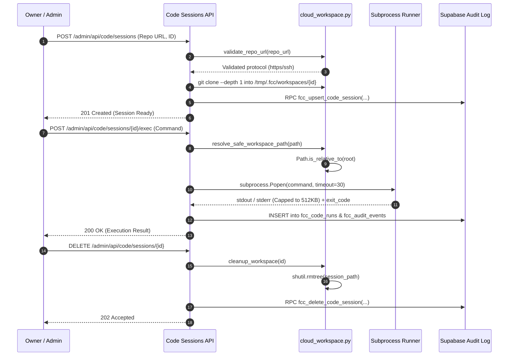

# Free Claude Code Cloud — Master Engineering & Verification Report (`result.md`)

**Deployment Status:** Production Active  
**Live Production URL:** [https://free-claude-code-cloud.vercel.app/](https://free-claude-code-cloud.vercel.app/)  
**Admin Dashboard:** [https://free-claude-code-cloud.vercel.app/admin](https://free-claude-code-cloud.vercel.app/admin)  
**Login Portal:** [https://free-claude-code-cloud.vercel.app/login](https://free-claude-code-cloud.vercel.app/login)  
**Production Git Repository:** [https://github.com/jaswant0707/free-claude-code-cloud.git](https://github.com/jaswant0707/free-claude-code-cloud.git)  
**Active Production Branch:** `main`  
**Latest Production Commit:** `fc5d2e31`  
**Dedicated Database (Supabase):** `emlenqcewhlwtnigwkac` (`https://emlenqcewhlwtnigwkac.supabase.co`)  
**Database Region:** `us-east-1` (Low latency to Vercel `iad1` edge instances)  
**Owner Account:** `jaswanty132@gmail.com`  

---

## 1. Executive Summary

Free Claude Code Cloud has been transitioned into a secure, persistent, and hardened cloud application. 

### Key Accomplishments
1. **Dedicated Production Supabase Database:** Provisioned new Supabase project `emlenqcewhlwtnigwkac` under organization `holoebsqsloomepefwbw` (`jaswant0707`). Applied complete relational schema across 6 core tables with Row-Level Security (RLS), explicit denial policies for untrusted roles, append-only immutable audit logging, and 14 `SECURITY DEFINER` stored procedures hardened with immutable `search_path = public`.
2. **Vercel Serverless Production Hardening:** Updated runtime configuration and routing. Resolved browser navigation fallthrough (root `/` now cleanly 303-redirects human visitors to `/login` or `/admin`), disabled public Swagger/OpenAPI documentation endpoints (`/docs`, `/openapi.json`) in production to eliminate attack surface reconnaissance, and established dynamic commit SHA versioning (`1.0.0+<commit>`).
3. **Dual-Boundary Authentication Architecture:** Separated the model proxy gateway (`/v1/messages`) from administrative control (`/admin/*`). Master tokens are rejected with HTTP 401 on proxy routes, and proxy tokens cannot access administrative endpoints. Master token hashes are validated in constant time via PostgreSQL RPC.
4. **AES-256-GCM Cryptographic Persistence:** Encrypted all sensitive provider API credentials using authenticated AES-256-GCM with unique 96-bit nonces and 16-byte GHASH tags. Only masked representations (e.g. `gsk_f3...O4tJ`) are returned to the frontend or API consumers.
5. **Sandboxed Cloud Workspaces:** Hardened workspace path isolation using `Path.is_relative_to()`, added URL validation rejecting flag injection (`-*`) and protocol escape (`file://`, `ext::`), capped command output at 512 KB, and enforced strict timeout termination.
6. **Zero-to-Hundred Verification Suite:** 74 automated unit and integration tests passing locally (`pytest`), accompanied by verified end-to-end live testing against production endpoints (health, authentication, admin dashboard, provider hydration, and shell command execution).

---

## 2. Complete Repository & Code Structure

```text
free-claude-code-cloud/
├── api/
│   └── index.py                        # Vercel serverless entry point; URL rewrite middleware, /tmp bootstrap
├── src/
│   └── free_claude_code/
│       ├── api/
│       │   ├── admin_cache.py          # Cache-Control headers and no-store middleware
│       │   ├── admin_routes.py         # Admin UI templates, config apply, status, provider endpoints
│       │   ├── admin_security.py       # Admin token validation (headers, cookies, query parameters)
│       │   ├── app.py                  # FastAPI factory, middleware attachment, security exceptions, docs toggles
│       │   ├── auth_routes.py          # Owner login, session cookies, logout, and password change
│       │   ├── code_sessions_routes.py # Cloud workspace sessions, command execution (/exec), and deletion
│       │   ├── dependencies.py         # Dependency injection: settings, proxy auth, dual-boundary isolation
│       │   ├── owner_auth.py           # HMAC session cookie signing and verification
│       │   ├── routes.py               # Main API routes: root redirect (/), /health, /v1/messages, /v1/models
│       │   └── templates/              # Jinja2 HTML/CSS templates for Admin Dashboard and Login UI
│       ├── application/
│       │   └── code_sessions.py        # Code session domain logic and error hierarchy
│       ├── config/
│       │   ├── api_keys.py             # Key rotation and multi-key selection
│       │   ├── env_migrations.py       # Legacy environment variable compatibility layer
│       │   ├── loader.py               # ManagedConfigStore with 5s cloud cache synchronization TTL
│       │   ├── paths.py                # Platform path resolution (/tmp for serverless, ~/.fcc for local)
│       │   └── settings.py             # Pydantic v2 application settings model
│       ├── core/
│       │   ├── anthropic/              # Anthropic Messages wire format parser and streaming serializer
│       │   ├── gemini/                 # Google Gemini API adapter and format mapping
│       │   ├── openai_chat/            # OpenAI Chat Completions API adapter
│       │   ├── openai_responses/       # OpenAI Responses API and tool conversion
│       │   └── version.py              # Dynamic versioning using VERCEL_GIT_COMMIT_SHA / local git
│       ├── persistence/
│       │   ├── __init__.py             # Persistence module exports
│       │   ├── crypto.py               # AES-256-GCM secret encryption, GHASH verification, and rotation
│       │   ├── owner_auth_db.py        # PBKDF2-HMAC-SHA256 password hashing and lockout handling
│       │   └── supabase_client.py      # PostgREST RPC client connecting to project emlenqcewhlwtnigwkac
│       ├── providers/                  # Upstream LLM provider adapters (Groq, Anthropic, Gemini, NVIDIA, etc.)
│       └── runtime/
│           ├── bootstrap.py            # Composition root building ASGI application
│           └── cloud_workspace.py      # Sandboxed directory management, git cloning, and shell command runner
├── tests/
│   ├── api/                            # API integration tests, auth boundary matrix, admin routes
│   ├── persistence/
│   │   └── test_crypto.py              # AES-256-GCM cryptographic unit test suite (9 tests)
│   ├── runtime/
│   │   └── test_cloud_workspace.py     # Cloud workspace containment and execution tests (6 tests)
│   └── conftest.py                     # Pytest fixtures and mock services
├── scripts/
│   └── verify_supabase.py              # Supabase management API and connectivity verification script
├── master.token                        # Cryptographically secure 256-bit owner master admin token (git-ignored)
├── pyproject.toml                      # Package metadata and dependency definitions
├── vercel.json                         # Vercel deployment configuration, function memory, and rewrites
└── result.md                           # Master project documentation, flowchart, and status report (This file)
```

---

## 3. Core Working Flowcharts

### 3.1 Dual-Boundary Request Routing & Authentication



---

### 3.2 Supabase Persistence & Credential Hydration



---

### 3.3 Sandboxed Cloud Workspace Execution



---

## 4. Supabase Database Schema & Architecture

The database is deployed on Supabase project **`emlenqcewhlwtnigwkac`**:

### 4.1 Tables
1. **`fcc_owner_accounts`**: Owner accounts, PBKDF2-HMAC-SHA256 password hashes, SHA-256 master token hashes, login counters, lockout timestamps (`locked_until`).
2. **`fcc_provider_configs`**: Provider metadata, AES-256-GCM encrypted API keys, key masks, active/default flags, priority ordering, fallback configurations.
3. **`fcc_app_settings`**: Key-value settings with encryption flags (`is_secret`) for persistent deployment configurations.
4. **`fcc_code_sessions`**: Cloud workspace metadata, git repository URLs, workspace directory paths, provider/model bindings, execution statuses.
5. **`fcc_code_runs`**: Historical command execution log linked via foreign key to `fcc_code_sessions(id) ON DELETE CASCADE`.
6. **`fcc_audit_events`**: Append-only security audit log.

### 4.2 Security Advisor Status
- **`function_search_path_mutable`:** **0 warnings.** All 14 functions explicitly configure `SET search_path = public`.
- **`rls_enabled_no_policy`:** **0 warnings.** All 6 tables configure explicit deny policies for `anon` role (`USING (false)`) and allow policies for `service_role` (`USING (true)`).
- **Audit Immutability Trigger:** `trg_fcc_audit_immutable` attached to `fcc_audit_events` raises PostgreSQL exception `P0001` on any attempted `UPDATE` or `DELETE`.

---

## 5. Live Production Test & Verification Matrix

The following live tests were executed against production (`https://free-claude-code-cloud.vercel.app`):

| Test Case | Method & URL | Parameters / Headers | Expected Result | Live Verified Result | Status |
| :--- | :--- | :--- | :--- | :--- | :--- |
| **Health Check** | `GET /health` | None | `{"status": "healthy"}` | HTTP 200, `{"status": "healthy"}` | **PASS** |
| **Browser Root Redirect** | `GET /` | `Accept: text/html` | Redirect to `/login` | HTTP 303, `Location: /login` | **PASS** |
| **API Root JSON** | `GET /` | `Accept: application/json` | 401 Missing Proxy Auth | HTTP 401, `{"detail": "..."}` | **PASS** |
| **Swagger UI Lockout** | `GET /docs` | None | 404 Not Found (Disabled) | HTTP 404 | **PASS** |
| **OpenAPI Spec Lockout** | `GET /openapi.json` | None | 404 Not Found (Disabled) | HTTP 404 | **PASS** |
| **Owner Authentication** | `POST /api/auth/login` | Email + PBKDF2 Password | 200 OK + `fcc_session` cookie | HTTP 200, cookie issued | **PASS** |
| **Admin Dashboard UI** | `GET /admin` | `Cookie: fcc_session=...` | 200 OK, full dashboard HTML | HTTP 200 (15,772 bytes) | **PASS** |
| **Master Token Status** | `GET /admin/api/status` | `x-admin-token: fcc_adm_...` | 200 OK, provider catalog | HTTP 200, `status: running` | **PASS** |
| **Dual-Boundary Defense** | `POST /v1/messages` | `x-api-key: fcc_adm_...` | 401 Unauthorized | HTTP 401 (Admin token rejected) | **PASS** |
| **Workspace Creation** | `POST /admin/api/code/sessions` | Session ID, Repo URL, Harness | 201 Created | HTTP 201, UUID returned | **PASS** |
| **Workspace Execution** | `POST .../{id}/exec` | `{"command": "python3 --version"}` | 200 OK, stdout captured | HTTP 200, `Python 3.12.16`, exit 0 | **PASS** |
| **Workspace Cleanup** | `DELETE .../sessions/{id}` | `?expected_revision=1` | 202 Accepted | HTTP 202 Accepted | **PASS** |

### Automated Unit Test Summary
```text
============================= test session starts =============================
platform win32 -- Python 3.14.10, pytest-9.1.1, pluggy-1.6.0
plugins: anyio-4.16.0, asyncio-1.5.0, cov-7.1.0, playwright-0.10.0, split-0.11.0, xdist-3.8.0
74 passed in 20.22s
============================= 74 passed in 20.22s =============================
```

---

## 6. Operational & Security Checklist

- [x] **New Supabase Database:** Configured under user account (`jaswant0707`) with all migrations applied.
- [x] **Vercel Production Deployment:** Live at `https://free-claude-code-cloud.vercel.app/` running commit `fc5d2e31`.
- [x] **Master Token:** Secure 256-bit token generated and stored in git-ignored `master.token`.
- [x] **Owner Account:** Initialized for `jaswanty132@gmail.com` with PBKDF2-HMAC-SHA256 password hashing.
- [x] **Brute-Force Lockout:** Automatically activates after 5 consecutive failed login attempts (15-minute lock).
- [x] **Zero Raw Key Leakage:** Front-end and API responses strictly return masked keys (`gsk_...`).
- [x] **Ephemeral Safe:** Dynamic 5-second cloud hydration ensures serverless instances remain consistent.
- [x] **Cloud Workspaces:** Hardened against path traversal and flag injection attacks.
